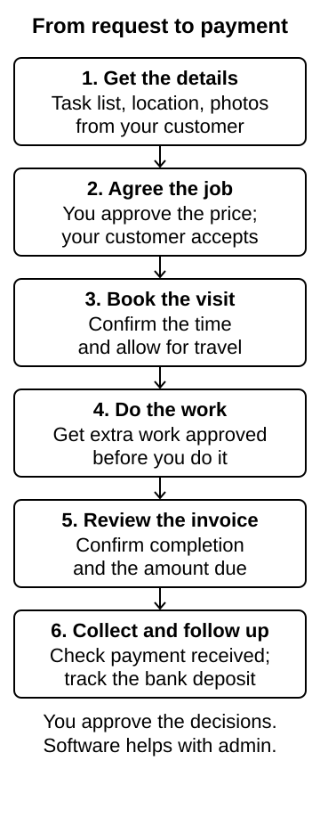
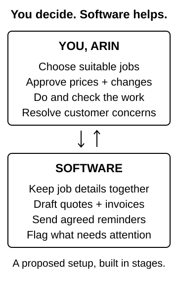
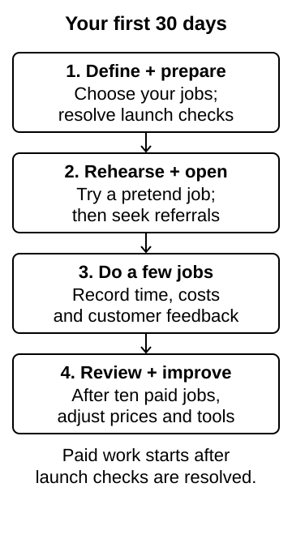

# Lean launch & operating plan

**Arin Handyman and Contracting** · Georgetown, Ontario. Arin, this is a practical plan to start small, earn from the work you do well, and keep everyday admin manageable.

Prepared: **October 23, 2026**. Sources last checked: **October 23, 2026**. Business planning document for Arin, version 1.1. Proposed services, prices and financial assumptions are for you to consider; they are not customer offers or verified business results.

## The business in one minute

**Build a small local repair business that fits the work you want to do.** You choose the jobs, agree the price, do the work and record completion on your phone. Software keeps the details together, prepares paperwork and reminds people what happens next. Aim for a system you can run yourself, with setup help arranged as needed.

Your first target is a few paid jobs a week around Georgetown. Bundle small tasks into one visit, learn the actual time and costs, then expand at a pace that suits you. Aim for C$0 in monthly software subscriptions initially; insurance, registration, tools, transaction fees and setup time are separate costs.

Start by testing which services customers will book at a price that pays you fairly. Your first jobs will also show how much admin the workflow can remove. You stay in charge of accepting work, approving changes and handling customer concerns; the aim is to make those decisions quick and keep the routine paperwork out of your way.

**Your first moves:** confirm the launch requirements, choose five jobs you can confidently do, set a trial price book, and walk through one pretend customer enquiry from request to receipt. Then seek your first paying customers. The software options below are choices to consider when useful, not purchases you need to make now.

## Start local and make the offer specific

Your existing website gives you a useful starting point: readable text, consistent cream/charcoal/orange branding and sourced homeowner articles. It labels concept imagery honestly and avoids invented reviews. Its seven broad service groups and Halton/GTA coverage should be narrowed to the jobs and area you choose for your launch.

It is currently a **front-end concept**: the phone number is a placeholder, the estimate form sends and stores nothing, and there is no booking, customer record or payment integration. This report leaves that behaviour unchanged.

**Proposed opening offer:** “Help with the small repairs and finishing jobs on your list, around Georgetown.” Target homeowners commissioning work at their own residence. Start in Georgetown and nearby Halton Hills addresses; add Acton on grouped route days. Use a roughly 20–30 minute one-way travel limit, checked for the actual appointment time. A smaller service area protects time that otherwise disappears into driving.

Begin with visible, clearly defined jobs you know you can do well. Refer electrical, plumbing, gas, structural, roof, hazardous-material and concealed leak/waterproofing requests to appropriately qualified providers. Consider larger renovations and property-manager/commercial work later, when your capacity, contracts, coverage and pricing support them.

### A candidate service menu and price book

These are **proposed starting prices for you to review**, not an established price list for your business. All amounts are Canadian dollars before applicable HST and separately quoted materials. Use **C$150 for a local visit including up to one hour, then C$90 per additional hour** as a trial estimating formula. Agree a written scope and price or a capped time allowance before work; extra time is never permission to charge without approval.

| Candidate service | Example planning allowance | Questions and exclusions before quoting |
| --- | --- | --- |
| Small repair list | C$150 / 1 hour; C$240 / 2 hours; C$420 / 4 hours | Get the complete task list and photos. Agree priorities and what fits; a time block is not a promise to finish an unlimited list. |
| Door and cabinet adjustments | C$150–240 for 1–2 hours | Identify the hardware and condition. Exclude structural movement, damaged frames, security/fire-rated systems and replacement doors from this basic scope. |
| Flat-pack assembly | C$150–330 for 1–3 hours | Ask for product link/model, item count, access and packaging condition. Confirm any anchoring requirement and lifting help before accepting. |
| Shelves, curtain rods and artwork | C$150–240 for 1–2 hours | Confirm item dimensions/weight, wall type, fixing system and access. Heavy items, uncertain substrates and concealed services require assessment; no electrical work. |
| Small drywall and paint repairs | C$300–480 for two visits of 1–2 hours each | Confirm damage is dry and understood, finish expectations and paint availability. Drying and colour matching can require extra visits. Exclude active leaks and suspect hazardous materials. |

The same visit minimum covers ordinary local travel and setup. For the pilot, show purchased materials at receipt cost, with purchasing time allowed for in the quote. Consumables are built into labour pricing. Disclose parking, disposal, unusual access and longer travel before acceptance. Price necessary return visits in the original scope; do not silently add another minimum when a known drying step requires a return.

Photo-based estimates are useful for simple work, but photos do not reveal every condition. If scope is unclear, agree an assessment and any fee first. Reconfirm scope on arrival. A fixed quote absorbs ordinary estimating errors; genuine customer changes need a written price/time change before proceeding.

### What published local prices tell us

| Business and advertised area | Published pricing observed | How to interpret it |
| --- | --- | --- |
| John The Handyman, Halton Hills | Small projects C$100–200; medium C$200–400. [1](#source-1) | Broad categories, not like-for-like quotes or proof of customer demand. |
| Star Handyman, Oakville | C$150 first hour, C$95 each additional hour; materials/hardware extra. [2](#source-2) | Supports testing a visit minimum rather than pricing only time on the tools. |
| 416Handyman, GTA | C$200 first hour, C$85 additional; possible travel charge, materials extra, HST stated separately. [3](#source-3) | Scope, location and charging terms differ. Do not copy its deposit or card-surcharge policy. |

These are a small sample of businesses' own advertised prices, checked on the date above, not a market average. The proposed C$150/C$90 formula is a hypothesis to test against both customer acceptance and actual costs. After ten jobs, adjust each category using total time, return visits and contribution after direct costs.

## Know what a job actually earns

**Illustration, not a forecast.** The model below assumes an average C$240 labour sale: two billable hours at the trial formula. Each job also takes 1.25 unpaid hours for travel, purchasing and administration. Allow a further two hours per week for general business admin. No demand or availability at these volumes is assumed.

Per job, allow C$25 for vehicle/travel costs, C$5 for consumables and C$7.02 for payment processing. The processing example uses Square's published Canadian online-invoice rate of 2.8% + C$0.30; it does not select Square. [4](#source-4) Fixed overhead is a **C$200/month placeholder**, pending real insurance, licence, equipment, bookkeeping and other costs. Existing tools, transport and phone access are assumed only for modelling and must be checked.

| Per four-week model month | 2 jobs/week | 5 jobs/week | 8 jobs/week |
| --- | ---: | ---: | ---: |
| Jobs completed and paid | 8 | 20 | 32 |
| Labour sales | C$1,920.00 | C$4,800.00 | C$7,680.00 |
| Variable costs, including processing | C$296.16 | C$740.40 | C$1,184.64 |
| Fixed overhead placeholder | C$200.00 | C$200.00 | C$200.00 |
| Cash available before paying yourself | C$1,423.84 | C$3,859.60 | C$6,295.36 |
| Your total time, including general admin | 34 hours | 73 hours | 112 hours |
| Allowance for your time at C$35/hour | C$1,190.00 | C$2,555.00 | C$3,920.00 |
| Surplus after allowing for your time | **C$233.84** | **C$1,304.60** | **C$2,375.36** |

The C$35/hour allowance puts a value on your time; it is not a payroll calculation. The final row is before income tax, any applicable self-employed CPP, reinvestment, financing, bad debts or unexpected callbacks. It is not take-home pay. The cash row must cover both your compensation and the business's remaining needs.

The formula is: **monthly surplus = jobs × (240 − 37.02 − 3.25 × 35) − 200 − 8 × 35**. On these assumptions, six paid jobs per four-week month cover costs plus the allowance for your time. This low break-even is sensitive to the unverified overhead and ticket assumptions. Every extra unpaid hour per job reduces surplus by C$35; C$300 more monthly overhead removes C$300 from the result. Each callback also consumes travel and materials.

Materials reimbursed at cost and HST are excluded from sales in this simplified model. Processing applies to the total charged, including materials and tax, so add those fees to actual job costs. HST collected is not operating income. A four-week month is a planning unit; twelve such periods represent 48 working weeks, not 52. Unpaid invoices are not cash received.

### Cash needed before the first job

Check what you already own before buying anything. Price the actual missing tools/PPE, transport and commercial vehicle use, insurance, municipal licence, business registration, contract/accounting setup and a small materials/callback reserve. Obtain quotes for these items; no premium or equipment budget has been verified. Ontario's published sole-proprietorship registration fee is C$60 when that registration route applies. [5](#source-5)

Use a separate business money trail and keep receipts against jobs. Have an accountant set the tax reserve and filing approach. C$0 monthly software is a useful constraint, not a claim that starting or operating the business is free.

## A phone-first job from enquiry to payment

Keep one private job record with contact details, address, scope/photos, accepted quote version, appointment, change approvals, time/materials, completion and payment status. You make the job decisions and handle customer exceptions. If you want help setting up or fixing the tools, agree the task, time commitment and any cost upfront. Your routine bookings and paperwork should be manageable from your own phone.

| Stage | You and your customer | Software's useful role |
| --- | --- | --- |
| Enquiry | Your customer sends a task list, location, photos and availability; you review whether it is a suitable job. | Create a draft job and flag missing information or out-of-area work. |
| Scope review | You accept, ask a question, arrange an assessment or refer the work. | Match the approved service menu and prepare scope/exclusions; uncertain requests remain unquoted. |
| Quote acceptance | You approve the price; your customer accepts the written version and terms. | Calculate from the price book and save the accepted version and timestamp. |
| Scheduling | You confirm a workable slot with your customer. | Add travel/setup buffers, check calendar conflicts and send agreed reminders. |
| Job | You check the scope on arrival, take permitted photos and record time/materials. | Show today's address, directions, task list and agreed price together. |
| Approved changes | You pause affected work; your customer approves the revised scope, amount and timing. | Record a separate change and update the total only after approval. |
| Invoice and payment | You confirm completion and the amount due; your customer pays or authorizes a permitted charge. | Prepare the invoice, send a hosted payment link and record confirmed payment/receipt. |
| Follow-up | You handle concerns; satisfied or dissatisfied customers may leave honest feedback. | Surface unpaid invoices and prepare a neutral follow-up with appropriate consent. |

**Payment rule:** “Work complete” can prepare an invoice; it must not invent a charge. Check the agreed amount due, disputes, changes and any applicable holdback first. Card-on-file storage/charging requires appropriate customer authorization. Square documents written authorization for storing a card; Jobber's native automatic payments apply to recurring jobs, which is different from one-off jobs in a repeatable service menu. [6](#source-6) [7](#source-7)

Track **invoice sent**, **customer paid** and **funds deposited** separately. A customer screenshot or an agent's guess is not payment confirmation. Any later integration must verify the processor's payment event and ignore duplicate notifications.

### Two possible daily routines

These examples show two ways you could manage a day from your phone. Try both and choose whichever feels easier to use. They illustrate a possible setup, not existing bookings or a working app.

| Moment | A simple phone screen | Texts and voice notes |
| --- | --- | --- |
| Before leaving | **TODAY · 1 job** → 9:30 am · Georgetown · approved repair list · C$240 labour. Buttons: Directions / Scope / Photos. | “Today: 9:30, repair list, C$240 labour. Open job details for address and scope.” |
| A new enquiry | **NEEDS REVIEW · 1 request** → photos, proposed duration and draft price. Buttons: Approve / Ask / Decline. | Send a voice note about suitability; receive a written draft quote to approve before it is sent. |
| A change on site | **CHANGE REQUEST** → added work, price and schedule impact; customer acceptance required. | Dictate the change; check the written amount and wait for recorded customer acceptance. |
| Work finished | Add photos/material receipt → **Review invoice** → **Send payment link**. | “Job finished” prepares a summary; confirm job ID, final amount and invoice before sending. |
| End of day | **NEEDS ATTENTION** lists unpaid, changed or failed items. | One short digest links to the same job records and exceptions. |

The screen is more structured and easier to validate. Voice can be easier while working, but transcription, identifying the right job and messaging integration add cost and failure points. The cheapest pilot can use the phone's existing dictation inside a private job form. Free consumer messaging alone does not provide a reliable automated business inbox.

## Buy outcomes, not a pile of apps

Use ordinary rules for totals, statuses and reminders. AI can help draft scope or summarize notes, with human review. A custom build can make the interface simple; running AI, phone/SMS services and maintaining the system are separate commitments. The operational system is a later project, not something installed by publishing this report.

| Outcome | C$0-monthly starting option | Alternative when useful | Limit or decision to test |
| --- | --- | --- | --- |
| Capture and find every job | Private forms, a job register, calendar and templates using existing accounts. | A custom authenticated phone interface over the same workflow. | Someone must set up permissions and ensure records do not fall between tools. |
| Prepare quotes and reminders | Rules and limited email automation; Apps Script is one example available without paid Workspace. [8](#source-8) | A managed field-service system. | Free quotas, failures and account ownership still need attention. |
| Collect payment and issue receipts | A hosted invoice/payment service with no monthly subscription; Square Invoices Free is one example. [9](#source-9) | Paid billing features or a unified job app. | Transaction fees remain; free billing does not automatically solve scheduling. |
| One clear phone workflow | Build a small private web app with Today / Review / Complete / Payment status. | Buy a tested field-service app. | More control over usability means more responsibility for login, backups and maintenance. |
| Reduce chasing and missed calls | Reusable replies, agreed callback windows, email reminders and an attention list. | Paid follow-up workflows or phone intake. | Spend only when measured missed work/admin time justifies it; no AI receptionist assumed free. |

A sensible first build is one private job record plus a clean phone view, quote/invoice preparation and a visible attention list. Add integrations after testing the workflow with fake jobs. Prefer a smaller reliable system over many partially connected automations.

The [optional software notes](#software-options-for-later) compare example products, prices and limits. You can leave those details until you are ready to choose your tools, or share them with someone helping you with setup.

### Ownership, recovery and exceptions

Keep ownership and recovery access for your business accounts, use multifactor authentication and give any helper only the access they need. Export job/financial records regularly, test restoration and keep an easy manual calendar/invoice fallback.

Customer addresses, photos and documents belong in a private operational store. Cards stay with the payment processor. Private API credentials belong on an authenticated backend. The repo and GitHub Pages hold public content/code and synthetic examples only; Pages is static hosting, not a private operations backend. [15](#source-15) Collect only needed information, restrict access and agree retention/deletion rules before launch; request separate permission to use job photos in marketing.

| Exception | Required behaviour |
| --- | --- |
| Missing photos, unclear scope or regulated work | Ask or refer; do not send an autonomous firm price. |
| Duplicate enquiry or overlapping appointment | Keep one job ID; flag conflicts and require confirmation before booking. |
| Customer unavailable or cancellation | Contact your customer and apply the agreed terms; no improvised cancellation charge. |
| Declined payment, dispute or refund | The system marks the job unpaid/disputed and alerts you. Review it before any further charge or refund. |
| Reminder/integration failure or quota reached | Keep the job visible in Needs attention, show the failed action and provide a manual fallback. Retry only when duplication is safe. |
| Connection lost while on site | Retain a minimal agreed job summary securely on the phone; record notes and reconcile once connected. Do not claim an unsent invoice was sent. |

Aim for a brief daily review you can handle yourself. Arrange technical support for specific tasks, with the time and cost agreed upfront. Measure the actual effort during your pilot. If the workflow needs daily coordination, simplify it or budget for support. Upgrade when a recurring bottleneck costs more in lost contribution or time than the proposed service, including setup and maintenance.

## Get the first customers without a marketing machine

Begin after the business is ready to accept work. Ask existing contacts for introductions, post a clear small-job offer in neighbourhood groups where permitted, and create an accurate service-area Google Business Profile. Google says profiles are free; a business visiting customers should hide its home address if it does not serve customers there. [16](#source-16) [17](#source-17)

Lead with the specific tasks, real service area and a simple request: “Send your list, a few photos and your area.” Follow up with a clear scope and price. Request honest reviews consistently after genuine work, without incentives or filtering only happy customers. Obtain permission before publishing project photos; avoid visible house numbers, faces and private interiors beyond the approved image.

Keep marketing separate from service communications. Commercial email/text outreach has consent, identification and unsubscribe requirements under CASL; an enquiry is not blanket permission for promotional blasts. [18](#source-18) No scraped contact lists or automated cold-text campaign is proposed.

Track where each enquiry came from, whether it was suitable, whether a quote was accepted and the resulting contribution. Start with C$0 paid advertising. Consider paid acquisition only when completed jobs demonstrate profitable pricing and capacity; evaluate customer acquisition cost against contribution, not revenue alone.

### Website readiness for a later launch

- Replace the placeholder contact details with approved business contact information and working phone links.
- Narrow advertised services and geography to the confirmed menu and permissions. Keep the exact business name.
- Add real, permissioned job photos and truthful business information; retain AI-concept labels wherever those images remain.
- Choose and test a secure intake destination with appropriate privacy information. The current demo form remains inactive until that separate work is authorized and implemented.
- Test a real enquiry, quote acceptance, reminder, invoice and payment confirmation before promoting the operational site.

## Complete the local launch checks once

Use these checks to confirm what is already in place and what you still need for your chosen services. This research does not verify your registration, licences, insurance or qualifications. Resolve the relevant checks before accepting work.

| Area | Verified guidance and action |
| --- | --- |
| Business registration | Ontario requires the relevant business-name registration when a sole proprietor trades under a name other than their full name. Confirm registration of **Arin Handyman and Contracting**, structure and banking. The listed sole-proprietor registration fee is C$60. [5](#source-5) |
| Halton Hills licence and insurance | The current application lists General Contractor/General Contracting Company under Specialty Trade and requests a C$2 million general-liability certificate. Confirm the correct category, documents and certificate wording with Licensing/broker. Applying alone does not authorize operation. This is required coverage, not an insurance-premium estimate. [19](#source-19) |
| Georgetown home base | Confirm permitted home administration, tool/material storage and vehicle arrangements with Zoning. Section 4.12 restricts home occupations, including garage/yard use and outside storage; do not assume a contractor's yard is permitted. [20](#source-20) |
| Written scope and changes | Halton Hills' general-contracting rules require signed written agreements including scope, estimate, payment terms and dates. Ontario guidance says an estimate included in a contract generally cannot be exceeded by more than 10% without agreement to new/different work. That is not a routine surcharge. Have a reusable contract reviewed for cancellation, permit and payment obligations. [21](#source-21) [22](#source-22) |
| HST and bookkeeping | CRA's C$30,000 small-supplier tests use taxable revenue, with different timing for a single quarter versus four consecutive quarters. Have the accountant confirm relevant revenues, registration and charging dates; monitor the threshold before crossing it. [23](#source-23) |
| WSIB | The home-renovation exemption depends on exclusively qualifying private-residence work retained and paid directly by the current/intended occupant or an eligible family member. Employees, property-manager work, working as a subcontractor or commercial jobs can change obligations. Confirm status rather than assuming every solo handyman is exempt. [24](#source-24) |
| Regulated work | Hired residential electrical work generally needs an ESA Licensed Electrical Contractor; plumbing is a compulsory trade; regulated fuels work has TSSA registration/certification requirements. Refer these requests initially rather than casually selling subcontracted work under your business name. [25](#source-25) |
| Payment terms and holdbacks | Have the contract reviewer classify the actual menu for cancellation rights and any Construction Act holdback. Applicable work and release rules need job-specific treatment; invoice size alone does not decide this. Automate only the approved amount currently due. [26](#source-26) |

One practical setup task: take the proposed five services and home-base/storage/vehicle arrangements to Halton Hills Licensing and Zoning. Keep the confirmation with business records. Recheck requirements before expanding into another municipality or changing the work/client mix.

## The first 30 days

Treat this as a sequence, not a promise to finish municipal or insurance approvals in a week. Paid work starts only after the relevant setup checks are resolved.

| Stage | Deliverable and decision |
| --- | --- |
| Days 1–7: define and prepare | Confirm your skills, tools, availability and preferred jobs. Obtain licensing/insurance/zoning answers and real startup costs. Review your contract and trial price book. Try both phone routines. |
| Days 8–14: rehearse and open | Choose a minimal workflow without a long subscription commitment. Test with fictional jobs: normal enquiry, unclear scope, schedule conflict, change order and failed payment. Once ready, ask for referrals and establish the service-area profile. |
| Days 15–21: do a few real jobs | Limit bookings to available capacity. Record all time, travel, materials, changes and payment dates. Ask permission for useful photos and request honest feedback. |
| Days 22–30: improve | Review completed jobs and fix the largest source of lost time or margin. Revise one service/price or one workflow at a time. Reach ten jobs when demand allows; do not buy leads just to hit the count. |

### Review after ten paid jobs

- **Profitability:** compare actual labour sales minus direct costs, allocated overhead and the value of your time with the model; include callbacks.
- **Time:** record on-site, travel, buying and admin minutes separately. Include any setup or support time someone contributes, even if unpaid.
- **Demand:** count suitable enquiries, quotes sent and quotes accepted by source. Diagnose scope/price objections rather than lowering every price.
- **Collection:** record completion-to-invoice and invoice-to-paid days, overdue balances and payment failures.
- **Ease of use:** you can comfortably find today's job, approve a quote/change, add a photo and finish an invoice on your phone. Target at most 10 minutes of routine admin per straightforward job after setup; this is a test target, not a guarantee.
- **Next decision:** keep, narrow or expand the service menu; adjust prices; automate the largest repeated task. Add a paid product only with a clear expected saving and an affordable fallback if it disappoints.

### Your next decisions

Choose your five strongest jobs and the work you will decline. Check the tools/PPE/transport you have, the hours you want to work and what you need to earn. Confirm your registration, insurance, licences and HST status. Choose how you prefer to use your phone and how you will handle urgent customer issues when unavailable. Your answers will turn this starting plan into a business that fits you.

## Software options for later

You can use these notes when you are ready to choose software, or share them with someone helping you set it up. You do not need to choose a platform now. Start with a workflow you find comfortable, then check that it protects your records and clearly shows anything needing attention.

- **Google tools + Apps Script:** possible C$0 subscription prototype. Consumer quotas currently include 100 email recipients/day, 90 minutes/day of trigger runtime and six minutes per execution; exceeding limits can stop automation. Triggers run under their creator's account and scheduled times can vary. [10](#source-10) [11](#source-11) Google Forms file uploads require the respondent to sign in, so do not require that path for every new customer. [12](#source-12)
- **Square Invoices Free:** Canadian page lists C$0 monthly. The standard Canadian online-invoice example is 2.8% + C$0.30, while card-on-file is 3.3% + C$0.15; foreign-issued cards add 1.5%. Confirm the applicable rate and plan at signup. [9](#source-9) [4](#source-4)
- **Jobber:** a paid unified option. Regular no-commitment pricing observed is US$49/month for Core with one user; Connect is US$139/month for one user or US$199/month including five users. Currency conversion, tax, processing and add-ons are additional; annual plans/promotions differ. Giving a helper separate access requires an appropriate user allowance. These prices are comparison points, not a recommendation to subscribe. [13](#source-13)
- **Custom app on a free backend tier:** feasible for a small pilot, subject to limits. Cloudflare Workers/D1 is one example: Workers' free tier lists 100,000 requests/day and D1 lists 5 GB total storage. Authentication and photo storage need their own design. [14](#source-14) A free hosting bill does not remove development or support work.

## Sources and research notes

Sources below were opened and read for this analysis, checked October 23, 2026. Product prices and limits can change; reconfirm before purchase. Contractor prices are advertised examples, not independently obtained quotations. Local/legal findings use primary authorities where accessible. Source 26 is regulator guidance on holdback procedures, not a determination that every handyman job is subject to a holdback. No professional legal, tax or trade review is claimed.

### Source 1

John The Handyman — [Handyman Halton Hills](https://calljohnthehandyman.com/handyman-halton-hills/).

### Source 2

Star Handyman — [Oakville Handyman Services: pricing](https://www.starhandyman.ca/oakville/).

### Source 3

416Handyman — [Pricing](https://www.416handyman.com/pricing/).

### Source 4

Square Canada — [Payment processing pricing](https://squareup.com/ca/en/pricing).

### Source 5

Ontario — [Sole-proprietorship registration instructions and fee](https://forms.mgcs.gov.on.ca/dataset/d329ad90-4ac4-41ce-b8d7-2dbd5a031a81/resource/411bb291-f94e-46a1-bb7a-af4a5865516b/download/5288e_instruction.pdf).

### Source 6

Square Canada — [Use card on file with Square Invoices](https://squareup.com/help/ca/en/article/5797-use-card-on-file-with-square-invoices).

### Source 7

Jobber — [Automatic payments](https://help.getjobber.com/en/articles/automatic-payments/).

### Source 8

Google Workspace — [Apps Script product FAQ](https://workspace.google.com/intl/en_US/products/apps-script/).

### Source 9

Square Canada — [Invoices pricing](https://squareup.com/ca/en/invoices/pricing).

### Source 10

Google Developers — [Apps Script quotas](https://developers.google.com/apps-script/guides/services/quotas).

### Source 11

Google Developers — [Installable triggers](https://developers.google.com/apps-script/guides/triggers/installable).

### Source 12

Google Docs Editors Help — [Respond to forms: file-upload requirements](https://support.google.com/docs/answer/15473134?hl=en).

### Source 13

Jobber — [Plans and pricing](https://www.getjobber.com/pricing/).

### Source 14

Cloudflare Developers — [Workers pricing](https://developers.cloudflare.com/workers/platform/pricing/) and [D1 pricing](https://developers.cloudflare.com/d1/platform/pricing/).

### Source 15

GitHub Docs — [What is GitHub Pages?](https://docs.github.com/en/pages/getting-started-with-github-pages/what-is-github-pages).

### Source 16

Google — [Marketing tools support: Business Profile cost](https://business.google.com/us/support/).

### Source 17

Google Business Profile Help — [Guidelines for representing your business](https://support.google.com/business/answer/3038177?hl=en).

### Source 18

CRTC — [Canada's Anti-Spam Legislation FAQ](https://crtc.gc.ca/eng/com500/faq500.htm/).

### Source 19

Town of Halton Hills — [Business licence](https://www.haltonhills.ca/town-hall/applications-forms-resources/licenses-permits/business-license) and [current application](https://www.haltonhills.ca/getContentAsset/01925fd3-4a8e-4654-9729-7c5a7915a607/5765e65f-0e8b-4885-a5ce-2084ab89c9fb/Application-Business.pdf?language=en).

### Source 20

Town of Halton Hills — [Zoning](https://www.haltonhills.ca/zoning) and [December 2025 zoning consolidation, section 4.12](https://www.haltonhills.ca/getContentAsset/b5b0b4c6-db46-4aaa-a5ec-7c2f8f6cf456/5765e65f-0e8b-4885-a5ce-2084ab89c9fb/ComprehensiveZoningBylaw2010-0050.pdf?language=en).

### Source 21

Town of Halton Hills — [Business Licensing Bylaw 2005-0067, Schedule G](https://haltonhills.ic12.esolg.ca/en/your-government/By-Laws/BY-LAW%20NO.%202005-0067.pdf).

### Source 22

Consumer Protection Ontario — [Contractors: contracts and estimates](https://www.publications.gov.on.ca/store/20170501121/Free_Download_Files/301658.pdf).

### Source 23

Canada Revenue Agency — [When to register for and start charging GST/HST](https://www.canada.ca/en/revenue-agency/services/tax/businesses/topics/gst-hst-businesses/when-register-charge.html).

### Source 24

WSIB — [Expanded compulsory coverage in construction: operational policy](https://www.wsib.ca/en/operational-policy-manual/expanded-compulsory-coverage-construction) and [policy examples](https://www.wsib.ca/en/policy-practice-expanded-compulsory-coverage-construction).

### Source 25

Electrical Safety Authority — [About Licensed Electrical Contractors](https://esasafe.com/hiring-an-electrician-or-contractor/). Skilled Trades Ontario — [Work in the compulsory trades](https://www.skilledtradesontario.ca/about-trades/work-in-the-compulsory-trades/). TSSA — [Contractor registration and certification](https://www.tssa.org/contractor-registration-and-certification).

### Source 26

Ontario Association of Architects — [Construction Act: procedures for release of statutory lien holdbacks, February 4, 2026](https://oaa.on.ca/Assets/Common/Shared_Documents/Practice%20Tips/PT.10.2_V03.0_CA-ProceduresForTheReleaseOfStatutoryLienHoldbacks_20260204.pdf).
